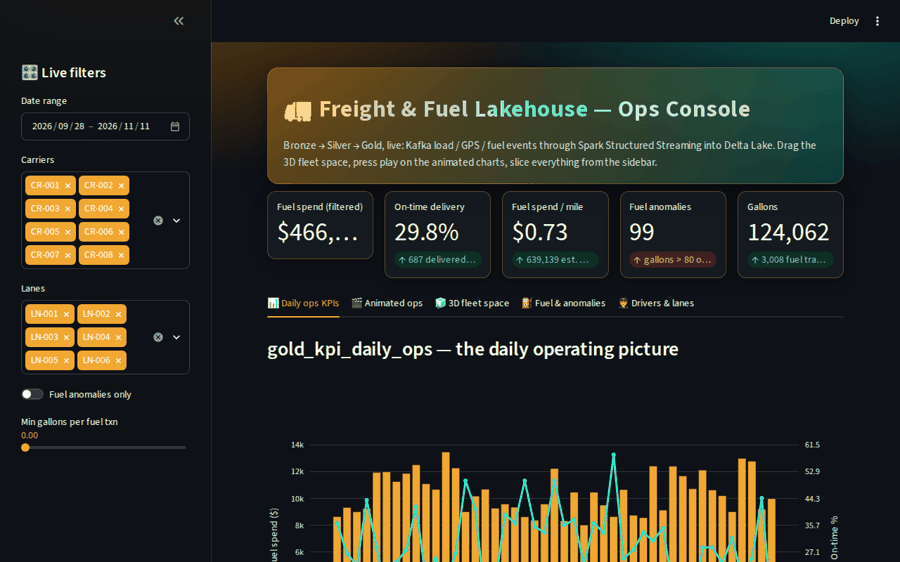

# Real-Time Freight & Fuel Lakehouse 

**Databricks | Spark Structured Streaming | Delta Lake | Kafka | AWS-Ready**



## The console

The Gold layer is served by an interactive ops console (`app/dashboard.py`, Streamlit + Plotly):

- **Live sidebar filters** — date range, carriers, lanes, a fuel-anomalies-only
  toggle and a minimum-gallons threshold; every chart, table and KPI re-renders
  instantly from the filtered Gold facts.
- **KPI cards with deltas** — filtered fuel spend vs. the prior equal-length
  period, on-time delivery %, fuel spend per mile, anomaly count and gallons.
- **Animated charts** — Plotly `animation_frame` views: daily fuel spend by
  lane and a cumulative spend race you can play, plus an animated load-lifecycle
  mix (created → assigned → picked_up → delivered).
- **3D fleet space** — a rotatable `Scatter3d` of GPS pings in
  longitude × latitude × speed space over the lane corridors, and a
  lane × date **surface terrain** of fuel spend (drag to orbit, scroll to zoom).
- **The Gold logic, visible** — `gold_kpi_daily_ops` as a daily operating
  picture, the `gold_fact_fuel_txn` anomaly rule drawn on the data
  (gallons > 80, or amount ≠ gallons × price), and driver utilization from
  `gold_fact_driver_movement` (est. miles = avg speed × hours observed).
- **Dark UI** — gradient hero header, glass KPI cards and a custom
  dark theme (`.streamlit/config.toml` + inline CSS).

The console runs standalone: `streamlit run app/dashboard.py`. It reads the
repo's Gold schemas and applies the same transformations as
`src/batch/build_gold_tables.py` and `src/batch/kpi_daily_ops.py`; with no
live Kafka/Spark stack running it serves a deterministic demo dataset built
from the producers' own distributions in `src/producers/`.

## Executive Summary
This project demonstrates my ability to design and implement a **cloud ready, real-time data lakehouse** that supoorts operational analytics in the transportation and logistics domain.

The platform ingests live freight, GPS, and fuel transaction events, processes them using **Spark Structures Streaming**, stores them in **Delta Lake Bronze/Silver/Gold layers**, and produces business-critical KPIs such as:
- On-time delivery %
- Dwell time
- Fuel spend per mile
- Driver utilization
- Rule-based fuel anomaly detection

The solution is built with production-greade patterns including:
- Streaming ingestion (Kafka)
- Delta Lake lakehouse architecture
- Data quality validation and quarantine
- Deduplication and watermarking
- Partitioning and performance optimization
- Modular, CI/CD-ready structure

This project directly reflects the requirements of a modern Data Engineering role workinbg with **Databricks, AWS, Spark, Kafka, and Delta Lake.**

---

## Business Context
Transportation ad logistics organizations rely on real-time operational visibility to:
- Reduce delivery delays
- Control fuel costs
- Detect fraud or abnormal spending
- Optimize fleet utilization
- Provide reliable data to analytics and BI teams

This system simulates a freight + fuel environment similar to a trucking technology or logistics-fintech company.

---

## Architecture Overview

### Streaming pipeline
Python Event Producers
↓
Kafka (Docker / MSK-ready)
↓
Spark Structured Streaming
↓
Delta Lake (Bronze → Silver → Gold)
↓
Operational KPIs + BI Tables

### Lakehouse Design
| Layer   | Purpose |
|----------|----------|
| Bronze  | Raw, append-only event ingestion |
| Silver  | Cleaned, typed, deduplicated, validated data |
| Gold    | Analytics-ready fact/dimension tables and KPIs |

---

## Technical Capabilities Demonstrated

### 1. Real-Time Data Engineering
- Kafka topic ingestion for:
  - Load lifecycle events
  - GPS tracking pings
  - Fuel transactions
- Spark Structured Streaming with:
  - Watermarking
  - Stateful aggregation
  - Deduplication by event ID

### 2. Delta Lake Lakehouse Implementation
- Bronze/Silver/Gold modeling
- Partitonin by event_date
- Optimized storage layout
- Ready for OPTIMIZE / ZORDER (Databricks)

### 3. Data Quality & Governance
- Schema enforcement
- Null and range validations
- Quarantine table for invalid records
- KPI-level consistency checks

### 4. Business-Driven Transformations

#### Gold Fact Tables
- `fact_load_status`
- `fact_fuel_txn`
- `fact_driver_movement`

#### KPIs Generated
- Daily on-time delivery rate
- Average dwell time
- Fuel spend per mile
- Driver utilization %
- Simple anomaly detection for excessive fuel transactions

### 5. Performance Considerations
- Partition pruning
- Reduced shuffle operations
- Efficient joins
- Streaming state control with watermarking

## 6. Production Readiness
- Modular codebase
- Environment configuration
- Checkpointing for streaming recovery
- Clear separation of ingestion, transformation, and analytics logic
- CI/CD folder strcuture

---

## Project Structure


--- 

## Key Engineering Decisions

### Why Streaming?
Freight and fuel transactios are operational events. Batch-only processing would delay insights and reduce responsiveness to delays or anomalies.

### Why Delta Lake?
Delta like enables:
- ACID transactions
- Schema enforcement
- Time travel capability
- Efficient analtics on streaming data

### Why Bronze/Siler/Gold?
This layered architecture ensures:
- Raw data preservation
- Clean business logic separation
- Scalable anlaytics development

---

## How to Run (Local Execution)

### 1. Start Kafka
```bash
docker compose up -d
```

2. Install Dependencies
python -m venv .venv
source .venv/bin/activate
pip install -r requirements.txt

4. Start Event Producers
python -m src.producers.produce_load_events
python -m src.producers.produce_gps_events
python -m src.producers.produce_fuel_txn_events

6. Run Streaming Jobs
python -m src.streaming.bronze_stream
python -m src.streaming.silver_stream

8. Build Gold Tables + KPIs
python -m src.batch.build_gold_tables
python -m src.batch.kpi_daily_ops

## Cloud Extension (Databricks + AWS)
This architecture is directly portable to:
- AWS S3 (storagr layer)
- MSK (Kafka)
- Databricks Structure Streaming
- Delta Live Tables (DLT)
- Unity Catalog (governance)
- Terraform (infastructure as code)
- Github Actions (CI/CD)

## Impact Summary
This project showcases:
- End-to-end streaming data pipeline design
- Lakehouse implementation best practices
- Business-oriented KPI modeling
- Data quality enforcement
- Performance-aware Spark engineering
- Cloud-ready architecture

It demonstrates readiness to contribute to teams working on:
- Databricks-based lakehouse platforms
- Real-time analytics pipelines
- Logistics and operational data systems
- AWS-integrated data architectures
